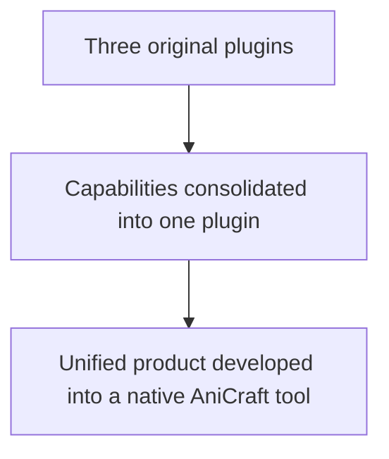
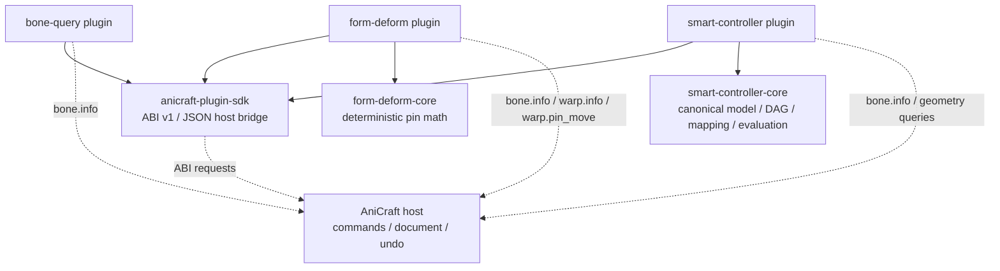
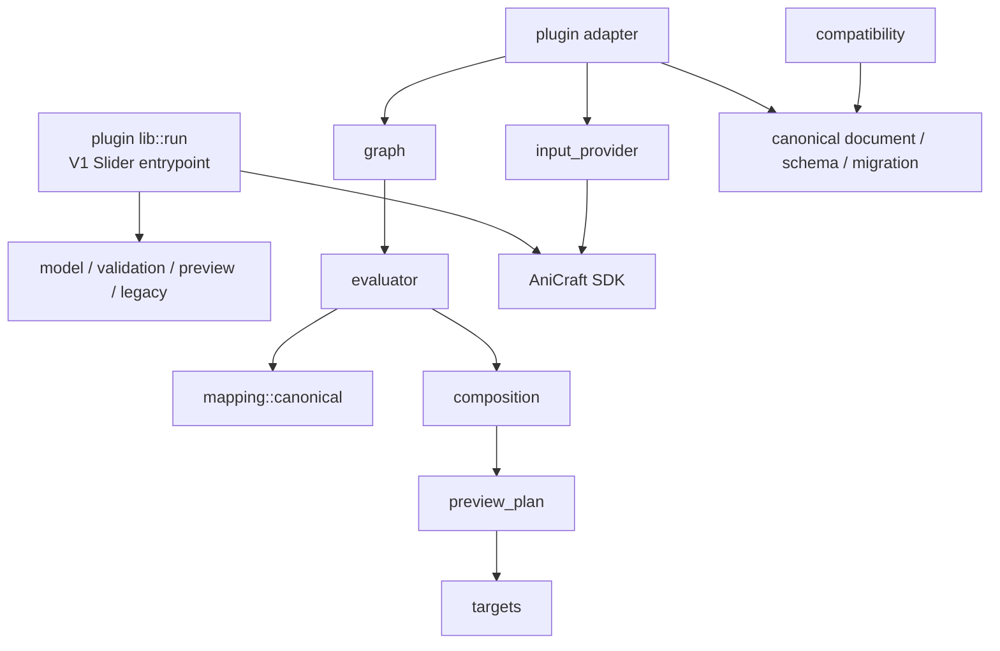

# CQ1 — Architecture and Module Responsibility Map

**Status:** CQ1 complete — architecture and module responsibilities mapped; implementation integration caveats recorded. Findings are proposals for review, not refactoring instructions.  
**Reference branch:** `main`  
**Reference commit:** `e7c7fef4e82345af311370426450146a4795523d`  
**Audit working branch:** `quality/cq0-audit-baseline`  
**Review date:** 2026-11-23

## 1. Executive summary

The repository must be understood as an evolutionary product, not just as a set of currently independent plugins. The product began as three plugins, those capabilities were merged into one unified plugin, and that unified product was subsequently developed into a native AniCraft tool. The code-quality audit therefore evaluates both the current architecture and the migration from the three-plugin design to the unified/native product. The current workspace still contains three plugin crates, but their presence in Cargo does not by itself establish that they are still independently shipped or are the intended product architecture.

At the code level, the repository has a sound high-level separation between AniCraft-facing WebAssembly adapters and host-independent Rust domain crates. In particular, Smart Controller's canonical model, input snapshots, graph evaluator, mapping layer, and target composition are separated from host input collection and preview planning.

The source review also found that the checked-in project-status documents lag the product history described by the owner: README.md calls the native tool proposed, and DEVELOPMENT.md labels native integration staged. These status statements must be reconciled with the actual native-tool implementation before future contributors use them as authoritative. The native host's Asset Warp/Bone/Bind tools are verified host capabilities, but they are not by themselves proof that the Forma Deform native workflow is integrated.

The most important architecture risks are at the edges of that structure:

1. Smart Controller exposes both a legacy binding model and a newer canonical model from the same crate root, including a wildcard legacy re-export. This makes the public domain surface harder to understand and evolve.
2. The Smart Controller WASM entrypoint currently executes the legacy V1 Slider preview path, while the richer canonical DAG/host-adapter pipeline is exposed through separate public modules and functions. The intended product status of that newer path needs to be explicit.
3. Several high-responsibility core modules are large (evaluator, composition, legacy compatibility, migration). Their internal phases and invariants need clear sub-boundaries before adding more features.
4. The AniCraft SDK is intentionally the only low-level ABI/unsafe boundary, which is a good design, but it should remain small and should not become a home for product-specific policy.

No evidence from this pass justifies merging the Smart Controller and Form Deform domain cores. They represent different concepts and currently have clean, independent dependency roots. In addition, AniCraft has native Asset Warp and bone/rigging tools in its host repository; their relationship to the Forma Deform cores must be traced before treating any overlapping algorithms as reusable or duplicated.

## 2. Product evolution and architectural interpretation

The product history supplied by the project owner is:

This history changes the audit criteria:

- The three plugin crates in the current workspace must be classified as historical source packages, compatibility/development adapters, or actively shipped products based on evidence; do not assume the third category from their directory names.
- Shared functionality should be evaluated across the original three capabilities and the unified/native implementation. Repetition may represent intentional compatibility or migration code, but it must be documented and must not become a second place to add new features.
- The native tool is the current product direction and, per the project owner's clarification, has been built. AniCraft already contains native Asset Warp, Bone, and Bind tools in its host repository. The Forma Deform native-tool composition root and exact calls into this repository's domain crates must be documented from implementation call sites; the native host's existence alone does not prove those calls. Plugin entrypoints and the guest SDK should be assessed as prototype/compatibility/integration boundaries, not automatically treated as the product's permanent top-level architecture.
- Domain cores should remain independent where they represent genuinely distinct domain concepts. Consolidation of the user experience does not require collapsing all domain logic into one crate.
- Persistence, document lifecycle, undo/redo, and native host integration belong to the AniCraft host boundary; the product adapter should not recreate host responsibilities.

The current repository evidence classifies the three plugin crates as independently buildable command-plugin prototypes/integration probes: README.md describes the Rust/WASM suite as a prototype track, and plugins/README.md lists the three independently buildable crates. This does not establish that they are still independently distributed products. For CQ1 they are therefore classified as **prototype/adapter surfaces**, not as the authoritative native product. This classification can be revised if release/package evidence shows ongoing independent distribution.

### 2.1 Native AniCraft deformation and rigging capabilities — integration evidence

Inspection of the current AniCraft host repository (Mujshanan/anicraft, branch main) confirms that deformation and rigging are not exclusively plugin concerns:

- src/warp_tool.rs implements the native **Asset Warp** stage tool. It displays warp meshes and pins, supports click/drag interactions, and issues host warp.* commands.
- crates/engine/src/cmds_warp.rs owns the native warp.add, warp.pin_add, warp.pin_move, warp.pin_remove, warp.remove, and warp.info command handlers.
- crates/doc/src/warp.rs owns the persisted warp model and deterministic deformation representation. Its module documentation describes the MLS deformation, bounded mesh/pin limits, keyframe behavior, and stale-warp rebasing.
- src/bone_tool.rs, src/bind_tool.rs, crates/engine/src/cmds_bone.rs, and crates/doc/src/armature.rs / skin modules implement native bone, binding, and weight-paint workflows.
- The host still has a separate WebAssembly plugin system: docs/plugins.md and crates/engine/src/cmds_plugin.rs describe plugin install/list/run/remove/reload and the sandboxed command bridge.

This establishes two distinct native-host subsystems: (1) built-in native deformation/rigging tools and document commands, and (2) the generic WASM plugin runtime. It does **not** yet prove that the Forma Deform workspace's canonical Smart Controller or Form Deform core is called by the native Asset Warp implementation. The inspected host source uses its own anicraft_doc::warp model and warp.* command layer; no direct Forma Deform dependency was found in the inspected host workspace manifest or the native tool files.

**Audit conclusion:** the architecture is a native AniCraft tool/workflow built on host-owned capabilities, with the three WASM plugin crates retained as prototype/integration adapters. The exact degree of code reuse between the native Forma Deform workflow and this repository's Rust cores is not visible in the inspected host entrypoints or workspace dependencies. This is recorded as an implementation traceability gap, not as evidence that the native tool does not exist. Do not merge or duplicate algorithms until that call path is documented.

## 3. Workspace responsibility map

| Workspace member | Responsibility | Owns | Must not own |
|---|---|---|---|
| `anicraft-plugin-sdk` | Guest-side AniCraft ABI v1 bridge | WASM imports/exports, JSON host requests, command/document helpers, plugin/exporter/ease macros | Controller domain rules, deformation math, application workflows |
| `smart-controller-core` | Host-independent Smart Controller domain | Canonical controller schema, typed inputs/snapshots, graph validation/order, mapping, evaluation, contribution composition, migration, diagnostics | AniCraft requests, WASM imports, UI, document writes, clocks |
| `form-deform-core` | Host-independent deformation calculation | Deterministic absolute pin-position calculation and its finite-value contract | AniCraft queries/commands, persistence, plugin UI |
| `bone-query` plugin | Read-only armature/bone inspection command | Parameter decoding, `bone.info` request, bounded report formatting | Document mutation, controller evaluation |
| `form-deform` plugin | AniCraft adapter for one bone-driven warp-pin operation | Host bone/warp queries, parameter validation, pure-core invocation, optional pin-move command | Reusable deformation mathematics |
| `smart-controller` plugin | AniCraft adapter and preview boundary | Host input acquisition, compatibility decoding, target capability checks, preview plan construction, command entrypoint | Core DAG/mapping/composition algorithms |

### 2.1 Smart Controller core module responsibilities

| Module | Current responsibility | Main collaborators |
|---|---|---|
| `canonical` | Canonical controller, binding, target and mapping configuration types | IDs, endpoint, value, contribution |
| `ids` | Strongly typed controller/input/binding/target identifiers | All canonical/evaluation modules |
| `value` | Typed scalar, angle and vector values | Input, mapping, contribution, composition |
| `input` | Input source/dimension definitions, validity/freshness metadata and immutable snapshots | Evaluator, adapter |
| `graph` | Validated controller DAG and deterministic topological order | Canonical model, evaluator |
| `evaluator` | Input preflight, dependency ordering, fallback handling, controller mapping dispatch, unavailable-output propagation, contribution collection | Graph, input, mapper trait, diagnostics |
| `mapping` | Pure mapping algorithms; canonical mapper plus easing/frame/range helpers | Canonical model, pose, value |
| `pose` | Pose/pose-binding data model and compatibility rules | Canonical mapper |
| `contribution` | Typed contribution and composition policy data | Evaluator, composition |
| `composition` | Deterministic post-pass combining contributions per target | Evaluator, contribution, value |
| `diagnostic_codes` | Stable machine-readable diagnostic codes and diagnostic value types | Evaluator, composition |
| `error` | Core error vocabulary | Core modules |
| `endpoint` | Shared inclusive/exclusive endpoint policy | Model, canonical mapping |
| `schema` | Versioned schema identity/envelope | Migration and serialized formats |
| `migration` | Legacy-format decoding, canonical migration and legacy export | Legacy model, canonical model, schema |
| `legacy` | Original V1 binding/parameter model and preview evaluator | Compatibility wrappers and migration |
| `model` | Original V1 parameters and mode | Legacy preview and validation |
| `preview` | Original V1 Slider/Transform preview result and orchestration | Model, mapping |
| `validation` | Original V1 parameter validation | Plugin entrypoint |
| `lib` | Module declarations and public re-exports | Public crate API |

### 2.2 Smart Controller plugin module responsibilities

| Module | Current responsibility |
|---|---|
| `lib` | ABI manifest and `run` entrypoint; current entrypoint validates V1 `Params`, queries `bone.info` or uses manual input, and logs Slider preview |
| `adapter` | Orchestrates canonical document validation, graph evaluation, composition and host preview session construction |
| `input_provider` | Converts explicit host context and `bone.info` data into typed core input snapshots |
| `compatibility` | JSON decoding and wrappers around core migrations/exports |
| `preview_plan` | Converts composed typed outputs into target-specific, read-only preview items |
| `targets` | Queries geometry information and assesses whether a canonical target is supported/previewable |

## 4. Dependency diagram

The following shows declared Cargo dependencies and the principal runtime call direction. Solid arrows represent crate dependencies; dotted arrows represent internal orchestration/call relationships.

### 4.1 Smart Controller internal call graph

**Important distinction:** this is a responsibility/call map, not a claim that the current `run` entrypoint invokes every module. The V1 entrypoint in `plugins/smart-controller/src/lib.rs` currently uses `Params`, `validation::validate`, `preview_slider`, and `bone.info`. The canonical adapter workflow is available separately through public adapter functions.

## 5. Architecture findings

### CQ1-01 — Legacy and canonical models share one crate-level public surface

**Priority:** P1 (public API clarity / future compatibility)  
**Evidence:**
- `crates/smart-controller-core/src/lib.rs:1-27` declares both canonical and legacy modules and uses `pub use legacy::*`.
- `crates/smart-controller-core/src/legacy.rs:1-10` describes the legacy pure model.
- `crates/smart-controller-core/src/canonical.rs:1-10` describes the canonical host-independent configuration model.
- `crates/smart-controller-core/src/migration.rs:1-15` bridges legacy and canonical formats.

**Why it matters:** A wildcard re-export makes the legacy API look like the default crate API and makes it harder for readers to distinguish stable canonical types from compatibility-only types. Given the product's progression from three plugins to a unified plugin and then a native tool, the legacy surface may be a deliberate bridge for existing data or workflows. The issue is not that legacy code exists; it is that its supported lifecycle and intended consumers are not obvious from the public API.

**Recommendation:** Keep both models while migration/compatibility requires them. First document which historical plugin formats and persisted documents the legacy model serves, which code path is authoritative for the native tool, and the deprecation/support policy. Then stop expanding the root wildcard surface where compatibility permits. Prefer explicit namespaces such as `legacy::` and `canonical::`; make any breaking export cleanup a planned API change with call-site inventory and migration tests.

**Acceptance:** New code uses canonical types through explicit canonical APIs; legacy types remain available through an explicitly named compatibility namespace; migration tests continue to pass.

### CQ1-02 — Canonical Smart Controller pipeline is not the current prototype plugin entrypoint path

**Priority:** P2 (prototype adapter scope clarity; native workflow call path must be documented)  
**Evidence:**
- `plugins/smart-controller/src/lib.rs:1-8` describes the entrypoint as a thin V1 preview adapter and declares the newer adapter modules.
- `plugins/smart-controller/src/lib.rs:44-75` implements the current `run` path: deserialize V1 `Params`, validate, query a bone or use manual input, call `preview_slider`, and log a preview.
- `plugins/smart-controller/src/adapter.rs:1-65` exposes a separate canonical document evaluation and composition workflow.
- `plugins/smart-controller/src/input_provider.rs:1-25` describes explicit host input collection.
- `plugins/smart-controller/src/preview_plan.rs:1-25` describes read-only target preview planning.

**Why it matters:** The WASM command-plugin entrypoint is a V1 prototype preview path. It is not a reliable proxy for the current native product workflow. A maintainer cannot infer how the canonical pipeline relates to the built native tool, which execution path is authoritative, or which plugin code is retained only as a probe. This risks maintaining parallel workflows or mistaking a callable library API for the actual user-facing native workflow.

**Recommendation:** Keep the native tool as the application composition root. Document its complete execution path (entrypoint, command/event registration, document state, controller loading, input acquisition, evaluation, preview/apply, and persistence) and identify which core functions are reused. Keep the old V1 `run` entrypoint classified as a prototype/integration probe unless release evidence establishes a compatibility commitment. Do not wire the canonical adapter into the old V1 `run` function merely to make the code paths look unified.

**Acceptance:** A documented workflow map identifies the actual WASM entrypoint for every user-visible mode; no public API is mistaken for a shipped host workflow.

### CQ1-03 — Evaluator is a high-responsibility module and should be decomposed by phase only when seams are stable

**Priority:** P2 (maintainability)  
**Evidence:**
- `crates/smart-controller-core/src/evaluator.rs` is approximately 1,071 lines.
- Its module documentation and public types describe input preflight, dependency ordering, unavailable-output propagation and contribution collection (`evaluator.rs:1-95`).
- The evaluation body also handles dependency-output fallback, mapper failures, binding validation, diagnostics and unavailable-output propagation (`evaluator.rs:260-380`).

**Why it matters:** This is central domain logic. A future contributor must understand multiple failure policies and execution stages in one file. The current phase-oriented comments are helpful, but the file's breadth increases the cost of reviewing changes and locating invariants.

**Recommendation:** First document the evaluator stages and their invariants. Consider extracting private helpers or private submodules for (a) snapshot/input preflight, (b) dependency resolution and fallback, and (c) output validation/contribution collection. Keep the public `evaluate` API and deterministic behavior unchanged. Do not split merely to reduce line count.

**Acceptance:** Each extracted unit has a single responsibility, focused tests, and no duplicated validation or policy logic.

### CQ1-04 — Legacy compatibility implementation remains a large, distinct domain surface

**Priority:** P2 (maintenance cost)  
**Evidence:**
- `crates/smart-controller-core/src/legacy.rs` is approximately 701 lines and contains the V1 model, validation, interpolation and tests.
- `crates/smart-controller-core/src/migration.rs` is approximately 478 lines and contains multiple migration and export paths.
- `plugins/smart-controller/src/compatibility.rs:1-25` delegates format compatibility work into core migrations.

**Why it matters:** Compatibility is necessary during the transition from the three original plugins through the unified plugin to the native tool. It can nevertheless become a permanent parallel implementation if new features continue to be added to legacy models instead of the canonical/native path.

**Recommendation:** Treat legacy modules as compatibility/migration code unless a specific supported workflow proves otherwise. New behavior should target the canonical/native path. Keep legacy changes limited to required bug fixes, import/export, and compatibility. Before declaring a module maintenance-only, verify the native tool no longer relies on its behavior.

**Acceptance:** Feature PRs identify whether a change belongs to canonical behavior or compatibility support; no new product capability is implemented only in legacy code without an explicit reason.

### CQ1-05 — AniCraft SDK is the correct low-level boundary; keep product policy out of it

**Priority:** P3 (guardrail / positive architecture observation)  
**Evidence:**
- `crates/anicraft-plugin-sdk/src/lib.rs:1-12` documents the ABI and sandbox contract.
- `crates/anicraft-plugin-sdk/src/lib.rs:14-55` contains the host imports and generic JSON request/command/document helpers.
- `crates/anicraft-plugin-sdk/src/lib.rs:90+` contains ABI entrypoint macros and allocation/dispatch helpers.

**Why it matters:** Centralizing unsafe ABI interactions is a strong safety and readability choice. The SDK should remain a generic transport/ABI layer; target-specific policies and Forma Deform behavior belong in plugin adapters or domain crates.

**Recommendation:** Preserve this boundary. Consider splitting the SDK internally only if the public file becomes difficult to navigate; do not create separate crates or abstractions without a demonstrated need. Add focused tests for malformed/empty host responses and ABI boundary assumptions where they can be tested safely.

**Acceptance:** Product-specific host command policy remains outside the SDK; unsafe operations remain localized and documented.

### CQ1-06 — Form Deform and Smart Controller cores should remain independent

**Priority:** P3 (positive architecture observation)  
**Evidence:**
- `crates/form-deform-core/src/lib.rs:1-45` contains a small pure deformation model and deterministic absolute-position function.
- `crates/smart-controller-core/src/lib.rs:1-27` defines a separate host-independent controller/evaluation domain.
- `plugins/form-deform/Cargo.toml` depends on the SDK and Form Deform core.
- `plugins/smart-controller/Cargo.toml` depends on the SDK and Smart Controller core.

**Why it matters:** The domains have different responsibilities: Smart Controller evaluates typed inputs into target contributions; Form Deform computes a deformation pin position. Combining them would create unnecessary conceptual coupling.

**Recommendation:** Keep the cores separate. If a future workflow needs both, coordinate them at a higher-level orchestration boundary, not by making one core depend on the other.

**Acceptance:** No cross-core dependency is introduced without a concrete shared domain concept and explicit design review.

### CQ1-07 — Plugin entrypoint files are suitable as composition roots, but should remain thin

**Priority:** P2 (maintainability guardrail)  
**Evidence:**
- `plugins/form-deform/src/lib.rs:1-120` currently performs parameter decoding, host queries, validation, core calculation, reporting and optional `warp.pin_move`.
- `plugins/bone-query/src/lib.rs:1-100` starts with manifest/entrypoint, host query, and report formatting in one file.
- `plugins/smart-controller/src/lib.rs:1-75` contains the current V1 manifest and run orchestration.

**Why it matters:** The old plugin entrypoints may now be migration shells or compatibility adapters rather than the main product composition roots. The native tool should have a clear composition root of its own. Treating the old plugin `lib.rs` files as the sole application architecture would obscure the actual product execution path.

**Recommendation:** Keep entrypoints as composition roots. Extract a module only when a concern grows independently (e.g. host response decoding, parameter parsing, reporting, or apply workflow). Avoid speculative one-function modules.

**Acceptance:** Each entrypoint reads like a short workflow and delegates substantive policy/algorithm logic to named modules.

## 6. Architecture strengths to preserve

- Domain cores have no direct AniCraft SDK dependency.
- Form Deform core is deterministic and non-accumulating.
- Smart Controller evaluator injects a `ControllerMapper` trait, keeping orchestration independent from mapping algorithms.
- Evaluation and target composition are separate stages.
- Host input collection requires explicit identity context instead of guessing layer/bone identities.
- Target preview planning is documented as read-only and separate from mutating host commands.
- AniCraft host operations are isolated behind the guest SDK.

## 7. Recommended dependency direction

Maintain this direction:

1. Domain models and algorithms depend only on domain types and serialization primitives.
2. Plugin adapters depend on the SDK and relevant domain core.
3. The SDK knows the ABI and generic host request envelope, not Forma Deform product policy.
4. The AniCraft host remains authoritative for document mutation, persistence, undo/redo, and evaluation lifecycle.
5. Cross-domain workflows coordinate at a plugin/application orchestration layer rather than coupling the two core crates.

## 9. CQ1 resolution and architecture decisions

CQ1 is complete as an architecture audit. The following decisions are adopted for the remaining code-quality review:

1. **Product architecture:** the native AniCraft tool/workflow is the product architecture. The three original plugins were consolidated into a unified product and the product then moved to a native-tool implementation, as clarified by the project owner.
2. **Plugin crate classification:** the three current WASM crates remain independently buildable in this repository, but the checked-in README describes them as prototypes/integration probes. CQ1 does not treat them as three separate shipped products or as the native product's application architecture.
3. **Host responsibility:** AniCraft owns the authoritative document, bone/rig model, Asset Warp, timeline, persistence, undo/redo, command registration, plugin lifecycle, rendering, and evaluation scheduling. Forma Deform owns deformation/controller domain rules and deterministic evaluation that are not already supplied by the host.
4. **Core boundaries:** retain `smart-controller-core` and `form-deform-core` as separate domain cores. Consolidating the user experience does not justify merging distinct controller and deformation domains.
5. **Legacy boundary:** preserve legacy V1 models and migration code for existing formats/workflows. New functionality should target canonical models and the native workflow. Do not remove root re-exports until downstream consumers and migration compatibility are inventoried.
6. **Native integration traceability:** a remaining documentation gap exists: the checked-in Forma Deform README and DEVELOPMENT.md still describe the native tool as proposed/staged, while the project owner confirms it has been built. The inspected AniCraft repository proves the existence of native Asset Warp/Bone/Bind host tools, but does not show a direct dependency on the Forma Deform crates in those inspected host files. This is a traceability/documentation issue, not a reason to block CQ1 or assume the native tool is absent.

### CQ1-08 — Product status documentation is inconsistent with the delivered native-tool history

**Priority:** P1 (project architecture/source-of-truth clarity)  
**Evidence:**
- Forma Deform `README.md`: describes the native tool as proposed and the WASM suite as a prototype.
- `DEVELOPMENT.md`: status says native integration is staged and must not be represented as complete.
- Project-owner clarification in the audit conversation: the three plugins were merged into one and a native tool was subsequently built.
- AniCraft host repository: native Asset Warp/Bone/Bind tool and command implementations exist, but inspected host source does not establish direct reuse of Forma Deform's Rust core crates.

**Finding:** Project documentation does not describe the same delivery state as the project owner's stated history. Contributors cannot tell whether the native tool is complete, where its composition root lives, and which of the three plugin adapters remain supported.

**Recommendation:** In a separate documentation update, name the native tool's source entrypoint and map its calls into the Forma Deform domain crates. Update README.md and DEVELOPMENT.md only after that implementation path is verified. Keep the three WASM crates explicitly labeled as prototype, integration probe, or compatibility adapter according to their actual distribution/support policy.

**Acceptance:** A new contributor can follow one source-backed path from the native tool entrypoint through input collection, canonical evaluation, preview/apply, and persistence; all project status documents agree on what is shipped and what remains prototype.

### CQ1 exit checklist

- [x] Product evolution and native-tool-first architecture recorded.
- [x] Workspace and core module responsibilities mapped.
- [x] Cargo dependency direction and Smart Controller internal call graph documented.
- [x] Native AniCraft host deformation/rigging responsibilities identified.
- [x] Three WASM plugin crates classified as prototype/integration adapters based on repository documentation, not assumed to be separately shipped.
- [x] Legacy/canonical model boundary and migration risk assessed.
- [x] Findings prioritized with file references and recommendations.
- [x] Remaining native-tool call-path and project-status documentation gap explicitly recorded.
- [x] No architectural refactor recommended without call-site evidence.

**CQ1 outcome:** complete. The architecture map is sufficient to proceed with CQ2–CQ8 without making speculative structural changes. The native-tool integration traceability gap should be resolved before any refactor that changes core ownership, plugin adapters, or host/domain boundaries.

## 10. Next step

Proceed with **CQ2 — Readability and code consistency**. Review naming, function size, nesting, documentation quality, and consistency in the context of the native-tool-first architecture. Keep review findings separate from implementation changes.
